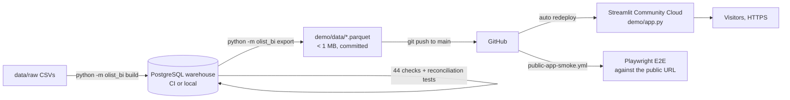

# Deployment and operations

**Live app:** https://olist-sales-analytics.streamlit.app (public, HTTPS, no sign-in required)

## Architecture

| Decision | Choice | Why |
|---|---|---|
| Hosting | Streamlit Community Cloud | Free, HTTPS, deploys from GitHub on every push to `main`, one-click reboot and a built-in log viewer. The app is already Streamlit, so no rewrite. |
| Data at runtime | Committed parquet aggregates | The dataset is historical and small once aggregated; a cloud database would add cost, credentials and a failure point with no benefit. |
| Secrets | None | The app reads only public, aggregated files. No credentials exist in the deployment. |
| Alternatives considered | Render / Railway (free tiers sleep or are credit-limited, need a container), Cloud Run (billing account, container build) | More moving parts for the same result. |

Deployment settings (share.streamlit.io → app → Settings): repository
`AC020907/olist-ecommerce-analytics-bi`, branch `main`, main file `demo/app.py`,
Python 3.13, dependencies from `demo/requirements.txt` (the requirements file next to
the app takes precedence over the root one), theme from `.streamlit/config.toml`.

## Provider limits (what "deployed" does and does not mean)

- **Sleeping:** Community Cloud puts apps to sleep after a period without visitors. The
  first visitor then sees "This app has gone to sleep" and wakes it with one click
  (~30–60 s). Persistent deployment, not a 24/7 availability guarantee.
- **Resources:** limited, shared CPU and memory; this app needs little (aggregates < 1 MB,
  loaded once and cached with `st.cache_data`).
- **No SLA**, public apps only on the free tier, and usage is subject to Streamlit's
  fair-use terms.

## Updating the data or the app

Every change goes through the same gates, either locally or in GitHub Actions:

1. **Ingest + transform:** `python -m olist_bi build`
2. **Validate:** `python -m olist_bi check` (fails on any error-level check)
3. **Export:** `python -m olist_bi export` (parquet, KPI reference, quality summary, export metadata)
4. **Reconcile + test:** `pytest` (64 tests, including demo-vs-SQL KPI reconciliation)
5. **Publish:** merge to `main` → Streamlit Cloud redeploys automatically
6. **Verify:** `public-app-smoke.yml` runs the Playwright tests against the public URL

Automated path: **Actions → refresh-demo-data → Run workflow** rebuilds, validates,
exports, tests and opens a pull request with the new snapshot; merging it publishes.
(Enable *Settings → Actions → General → Allow GitHub Actions to create and approve pull
requests* once.)

## Monitoring

- **`public-app-smoke`** (GitHub Actions): after every push to `main`, weekly (Monday
  12:00 UTC) and on demand. It wakes the app if asleep, checks the KPIs against the
  committed data, opens every section, applies a filter, checks the mobile layout and
  fails if a Python exception is on screen. GitHub e-mails the repository owner on failure.
- **App logs:** share.streamlit.io → app → *Manage app* → logs. The app logs data-load
  time and the filters applied (no visitor-identifying data), and failures to load data.
- **CI** (`ci.yml`): every push builds the warehouse twice and runs all checks and tests.

## Troubleshooting

| Symptom | Cause | Fix |
|---|---|---|
| "This app has gone to sleep" | Inactivity | Click the wake button; it restarts in under a minute. |
| "The dashboard data could not be loaded" | Missing/corrupt parquet in `demo/data/` | Re-run `python -m olist_bi export`, run tests, push. |
| Deploy fails on install | Dependency incompatible with the selected Python | Check *Manage app* logs; keep `demo/requirements.txt` pins aligned with CI (Python 3.13). |
| Numbers differ from SQL | Stale export | `refresh-demo-data` workflow, or rebuild + export locally; reconciliation tests will flag it. |
| Smoke test fails right after a push | Redeploy still running | Re-run the workflow after a few minutes. |

## Security and privacy

- No secrets, tokens or database connections in the app or repository (`.env` is git-ignored).
- The app serves only aggregated, anonymized public data; no personal data, no visitor
  tracking beyond Streamlit's own platform analytics, no authentication needed.
- Inputs are limited to widget options generated from the data; the period is validated
  before use.

## License

The data is the Brazilian E-Commerce Public Dataset by Olist (Kaggle, CC BY-NC-SA 4.0).
The app shows attribution and the license in its sidebar and methodology tab, is a
non-commercial portfolio project, and is not affiliated with Olist. Code is MIT.
